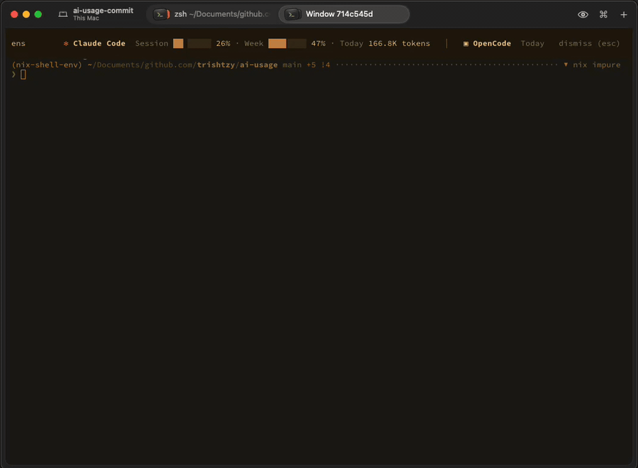

# ai-usage

A usage bar for [Rex](https://www.superlogical.com/rex/docs). One action
floats a bar across the top of the current tab, showing your AI plan limits
and today's tokens for Claude Code, Codex, OpenCode, Cursor, Grok, Gemini CLI
and Qwen Code, plus any other provider whose API responses you log:



It reads the data those tools already keep on your machine, so it needs no
API keys or network access. The bar scrolls like a ticker when it's wider
than the tab, and rereads usage every 30 seconds.

## Let your agent set it up

Paste this into Claude Code, Codex or another coding agent running on the
machine Rex runs on:

````text
Set up the ai-usage bar for Rex from https://github.com/trishtzy/ai-usage.

1. Install the ai-usage binary: `nix profile install github:trishtzy/ai-usage`
   if Nix is available, otherwise
   `cargo install --git https://github.com/trishtzy/ai-usage`.
   Find its absolute path with `command -v ai-usage`.
2. Clone the repo to ~/src/ai-usage, unless it's already there.
3. Find the Rex config: $XDG_CONFIG_HOME/rex/init.lua, or
   ~/.config/rex/init.lua. Append these lines, keeping everything already
   in the file, and skip this step if it already requires "ai_usage":

     package.path = os.getenv("HOME") .. "/src/ai-usage/rex/?.lua;" .. package.path
     require("ai_usage").setup{ bin = "<absolute path from step 1>" }

   Ask me whether I want a key bound to it, such as "cmd+shift+u", and if
   so add `key = "..."` to the setup table.
4. Run `rex config reload` and check it reports no errors.
5. Check `rex actions` lists `ai_usage`. Run `rex do ai_usage` to open the
   bar, then `rex block ls` to find the block labelled "AI usage" and
   `rex capture -b <id>` to confirm it shows usage, not an error.
   Run `rex do ai_usage` again to close it.
6. Claude Code's plan limits need ai-usage as Claude Code's status line.
   Look at "statusLine" in ~/.claude/settings.json. If it's unset, set it to
   {"type": "command", "command": "<absolute path> claude-statusline"}.
   If it's already set, show me what's there and ask before replacing it.

Tell me how to open the bar when you're done.
````

## Add it to Rex

### 1. Install the `ai-usage` binary

With Nix:

```sh
nix profile install github:trishtzy/ai-usage
```

With Cargo:

```sh
cargo install --git https://github.com/trishtzy/ai-usage
```

Note the full path it was installed to (`command -v ai-usage`). You'll give
it to Rex in the next step, since the Rex server doesn't necessarily share
your shell's `PATH`.

### 2. Get the Rex module

The module is the single file `rex/ai_usage.lua` in this repo. Clone the
repo somewhere it can stay:

```sh
git clone https://github.com/trishtzy/ai-usage ~/src/ai-usage
```

### 3. Load it in `init.lua`

Add this to `~/.config/rex/init.lua` (or `$XDG_CONFIG_HOME/rex/init.lua`):

```lua
package.path = os.getenv("HOME") .. "/src/ai-usage/rex/?.lua;" .. package.path
require("ai_usage").setup{
  bin = "/Users/you/.nix-profile/bin/ai-usage", -- from step 1
  key = "cmd+shift+u",                          -- optional
}
```

Then reload the config:

```sh
rex config reload
```

### 4. Open the bar

Any of these toggles it, opening the bar or closing it again:

- Press the key you bound, if you set `key`.
- Search for **Toggle AI Usage** in the command palette.
- Run `rex do ai_usage` from a terminal.

The bar takes focus when it opens, so Esc closes it straight away. Clicking
**dismiss (esc)** closes it too.

## Options

`setup` takes a table, and every option is optional:

| Option       | Default                       | Meaning                                                   |
| ------------ | ----------------------------- | --------------------------------------------------------- |
| `bin`        | `ai-usage` on Rex's `PATH`    | Path to the `ai-usage` binary                             |
| `key`        | none                          | A key to bind the action to, such as `"cmd+shift+u"`      |
| `interval`   | `30`                          | Seconds between rereading usage                           |
| `rows`       | `3`                           | The bar's height when it opens                            |
| `background` | `"black"`                     | `"black"` (the theme's palette black) or `"#rrggbb"`      |
| `sources`    | none                          | Other providers, as `{ name = "/log/dir" }` ([below](#other-providers)) |

The bar always opens along the top. Rex can't yet place a floating pane
along the bottom correctly.

## Show Claude Code's plan limits

Token counts work as soon as the bar is installed. Claude Code's plan limits
(the session and weekly percentages) need one more step, because Claude Code
hands them only to its status line command. Make `ai-usage` that command in
`~/.claude/settings.json`:

```json
{
  "statusLine": {
    "type": "command",
    "command": "/Users/you/.nix-profile/bin/ai-usage claude-statusline"
  }
}
```

It saves each update for the bar to read, and shows the limits as Claude
Code's status line, such as `5h 14% · 7d 46%`. Codex's and Grok's limits are
read from their own logs and need no setup. The other tools keep no plan
limits on disk, so they show tokens only.

## Other providers

For a provider ai-usage doesn't read itself, such as DeepSeek's API used
directly or a private router like Longwire, log its API responses and point
ai-usage at them:

```sh
ai-usage --source longwire="$HOME/.local/share/ai-usage/longwire"
```

In Rex, pass them to `setup`:

```lua
require("ai_usage").setup{
  bin = "/Users/you/.nix-profile/bin/ai-usage",
  sources = { longwire = "/Users/you/.local/share/ai-usage/longwire" },
}
```

ai-usage reads every `.jsonl` file under the directory. Each line is one API
response, exactly as it came back:

```json
{"id":"chatcmpl-1","created":1792573200,"model":"deepseek-chat","usage":{"prompt_tokens":1000,"completion_tokens":50,"prompt_cache_hit_tokens":800}}
```

It understands the usage of OpenAI-compatible chat completions (DeepSeek,
OpenRouter, most routers), OpenAI's Responses API, and Anthropic's Messages
API. A line's time comes from the response's `created` or `created_at`.
Anthropic responses carry no time, so wrap them:

```json
{"timestamp":"2026-10-21T09:00:00Z","response":{"id":"msg_1","model":"claude-opus-5-5","usage":{"input_tokens":10,"output_tokens":5}}}
```

Something has to write these lines: ai-usage only reads them. The simplest
is to append each response as your script or proxy gets it, for example
`curl … | tee -a ~/.local/share/ai-usage/longwire/2026-10.jsonl`. When
streaming, usage arrives only in the last chunk, and only if the request
asks for it (`"stream_options": {"include_usage": true}` for OpenAI-style
APIs). Log that chunk or the assembled response, not the raw stream.

Don't add a source for a model you use through an agent ai-usage already
reads, such as DeepSeek through OpenCode, or it's counted twice.

## Troubleshooting

**The bar says "No such file or directory".** `bin` doesn't point at the
binary. Check the path, then run `rex config reload`. Rex keeps using the
config it last loaded until you reload, so this also happens after moving
the binary or the repo.

**A provider is missing.** The bar shows only providers used today. If you
keep a tool's data somewhere unusual, ai-usage follows `CLAUDE_CONFIG_DIR`,
`CODEX_HOME`, `XDG_DATA_HOME`, `GROK_HOME`, `GEMINI_CLI_HOME`,
`QWEN_RUNTIME_DIR` and `QWEN_HOME` as the server sees them. Qwen Code
writes its usage ledger only while its usage statistics setting is on, which
is the default.

**Rex runs on another machine.** The bar runs on the Rex server, so it
reads usage from that machine, and `bin` must be a path there.

## Using it outside Rex

`ai-usage` is also a plain CLI:

```sh
ai-usage                      # plan limits and today's tokens, one card per provider
ai-usage status --watch 30    # redraw every 30 seconds, until Esc or Ctrl-C
ai-usage status --json
ai-usage tokens --since 7d    # token totals per model: today, all, 5h, 30m, 7d...
ai-usage tokens --format line # one short line, for a tab or session label
ai-usage bar                  # the bar itself, in any terminal
```

`--claude-dir`, `--codex-dir`, `--opencode-dir`, `--cursor-db`,
`--grok-dir`, `--gemini-dir` and `--qwen-dir` point it at data kept
somewhere other than the default, and `--source` adds
[other providers](#other-providers).

| Provider    | Tokens from                                                | Plan limits from            |
| ----------- | ---------------------------------------------------------- | --------------------------- |
| Claude Code | `~/.claude/projects` session logs                          | Its status line (see above) |
| Codex       | `~/.codex/sessions` session files                          | Its session files           |
| OpenCode    | SQLite databases in `~/.local/share/opencode`              | None                        |
| Cursor      | Its chat store, `Cursor/User/globalStorage/state.vscdb`    | None                        |
| Grok Build  | `usage.json` in each session under `~/.grok/sessions`      | Its log, `~/.grok/logs`     |
| Gemini CLI  | Chat recordings under `~/.gemini/tmp`                      | None                        |
| Qwen Code   | Its usage ledger, `~/.qwen/usage/token-usage-*.jsonl`      | None                        |

## Development

`nix develop` gives a shell with the Rust toolchain and Lua 5.1, the version
Rex runs.

```sh
cargo test
cargo clippy
luac -p rex/ai_usage.lua
nix build                     # builds ./result/bin/ai-usage
```

## License

MIT. See [LICENSE](LICENSE).
